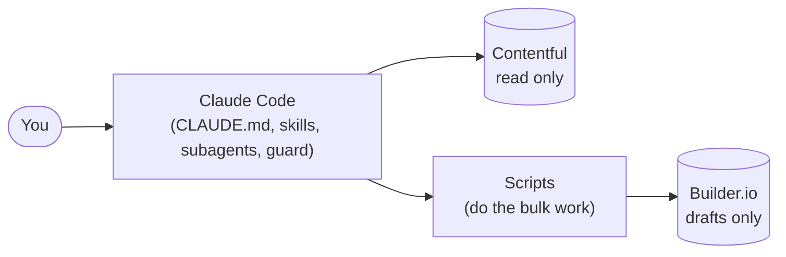
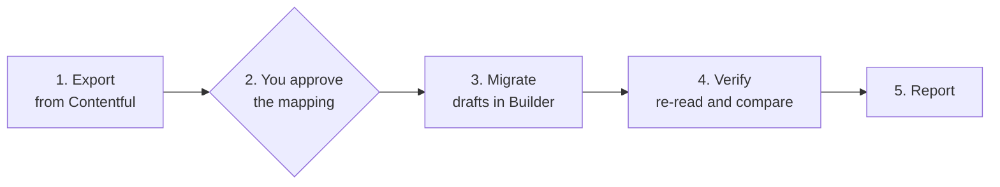
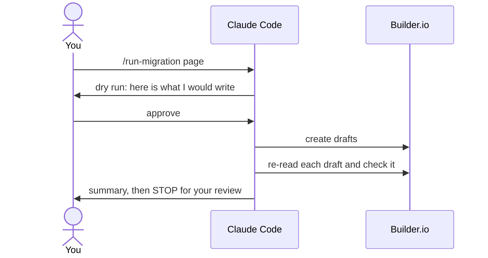
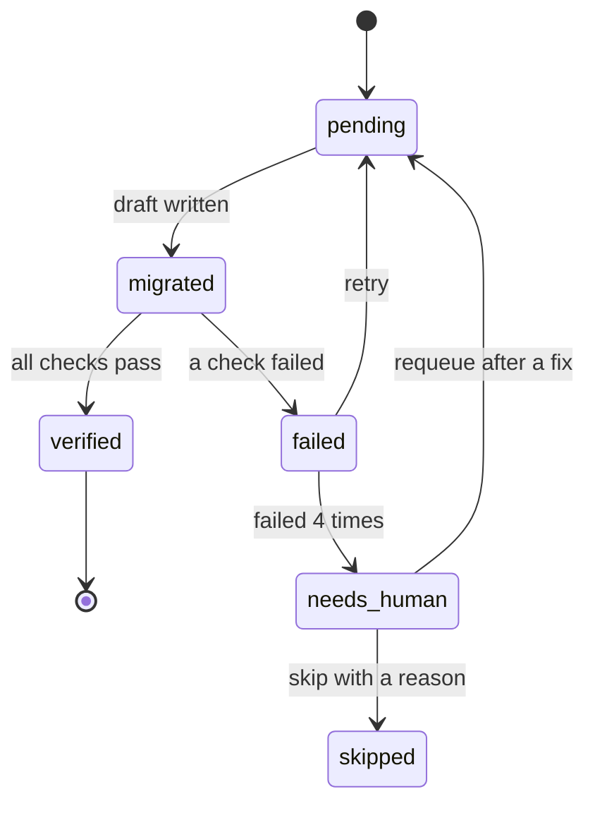
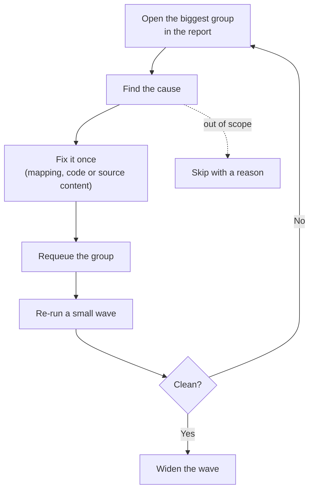

# Contentful → Builder.io migration pipeline, run with Claude Code

This repo is a **[Claude Code](https://claude.com/claude-code) project**. Open the folder in Claude Code and it becomes a
migration orchestrator: `CLAUDE.md` gives Claude the rules and the loop, **project skills** give you slash commands for
the common jobs, three **subagents** do the per-entry work, and a permission and hook layer keeps it **read-only on
Contentful and draft-only on Builder.io**. Deterministic Python scripts do the heavy lifting at volume, and you can also
run them on their own, without Claude Code (see [Running the scripts directly](#running-the-scripts-directly-without-claude-code)).

> **Status: a working pilot, not a production-hardened tool.** It was developed and exercised against a small
> sandbox (10 Contentful entries → 2 Builder pages, all verified, nothing published). The scale-up scripts exist and
> are unit/integration tested with a mocked Builder, but they have **not been run against hundreds or thousands of
> entries**. See [Known limitations](#known-limitations) before relying on it.

## Quick start (with Claude Code)

You need [Claude Code](https://docs.claude.com/en/docs/claude-code/overview), Python 3.9+, a Contentful space you can read, a
Builder.io space (use a sandbox first), a Builder **Private API Key** and a Contentful **Delivery** token (the scripts use
them; the MCP servers use OAuth).

```bash
git clone <this repo> && cd mcp-contentful-to-builder
cp .env.example .env     # add your tokens (Claude's Read tool is denied this file; never paste its contents into the chat)
claude                   # start Claude Code in this folder
```

Then, inside Claude Code:

1. **Connect the MCP servers.** Approve the project's `.mcp.json` (the Contentful MCP server) when prompted, run `/mcp`
   to authenticate it (OAuth), and make sure the **Builder.io** connector is connected. In Contentful's MCP app, enable
   read-only tool categories only.
2. **`/setup-migration`**: a guided setup. It creates your mapping from the example, runs the read-only export,
   proposes a mapping, and then **stops for you to review and approve it** (approval is always yours). Run
   **`/map-content-model`** when you want help deciding how each content type lands in Builder (page, component,
   section model or data model); it lists what the pipeline cannot carry yet.
3. **`/run-migration page`**: a pilot run of one content type. It dry-runs first, shows you what it would write, asks
   before writing, creates **drafts**, verifies them, and **stops for your review**. Nothing is published.
4. **`/migration-report`**: refreshes the state and builds the HTML report site (`reports/site/index.html`).
5. **`/triage-needs-human`**: works through entries the pipeline stopped on, one cause at a time.

You can also just talk to Claude in this folder ("migrate the page content type as a pilot"): `CLAUDE.md` and the skills
tell it how.

## How Claude Code runs this repo

| Claude Code feature | File | What it does here |
|---|---|---|
| Project instructions | `CLAUDE.md` | The orchestrator's rules: the batch loop, the pilot-first limit, the safety rules, the status lifecycle |
| Skills (slash commands) | `.claude/skills/*/SKILL.md` | `/setup-migration`, `/map-content-model`, `/run-migration`, `/migration-report`, `/triage-needs-human`: the workflows you run |
| Subagents | `.claude/agents/*.md` | `migrator` (maker), `verifier` (checker), `reporter`: do the per-entry work and return short summaries |
| Permissions | `.claude/settings.json` | `allow` / `ask` / `deny` rules: Contentful write tools denied, bulk changes ask, `.env` unreadable |
| Hook | `scripts/guard.py` via `settings.json` | A `PreToolUse` hook that blocks any Contentful write and any Builder publish, delete, archive or symbol creation |
| MCP servers | `.mcp.json` + the Builder.io connector | Read Contentful, write Builder drafts |
| Deterministic engine | `scripts/*.py` | Export, transform, write, verify, reconcile, report: the work that must not be improvised |



The **main Claude Code session is the orchestrator** (subagents cannot spawn subagents): it reads `CLAUDE.md`, claims
batches from the manifest, and hands them to the agents or runs the scripts. A skill is just a saved, reviewable version
of that procedure.

### What flows where



Two ways to run the same roles:

| Role | Agent (`.claude/agents/`, LLM) | Script (deterministic, no LLM) |
|---|---|---|
| Maker | `migrator` | `scripts/run_migration.py` |
| Checker | `verifier` | `scripts/run_verification.py` |
| Reporter | `reporter` | `scripts/reconcile.py`, `scripts/seo_redirect_check.py` |

The scripts do the claim → write → verify loop without an LLM; the agents remain for pilots and for the exceptions the
scripts flag (`needs_human`, fuzzy items).

### One batch, step by step



### Status lifecycle



`skipped` means *deliberately not migrated* (a human decision): it is not work and not "needs attention".

## Skills

Project skills live in `.claude/skills/<name>/SKILL.md`, are versioned with the repo, and are invoked as slash
commands. The ones that can write are marked **you start it**: Claude will not launch them on its own.

| Skill | Use it to | Writes? |
|---|---|---|
| `/setup-migration` | Configure a new space: mapping, export, proposal, your approval | Local files only (mapping, `exports/`, manifest seed) |
| `/map-content-model [content type]` | Classify each type (page, inline component, shared section, data record), propose Builder targets, list what the pipeline cannot carry yet | Local proposal files only |
| `/run-migration [content type]` | Pilot or wave: dry run → approve → drafts → verify → report → stop | **Builder drafts and the manifest. You start it.** |
| `/migration-report` | Refresh derived state and build the HTML report site | Local `reports/` and `exports/` id maps only |
| `/triage-needs-human` | Group the stuck entries, fix each cause once, requeue or skip | **Manifest changes, after your approval. You start it.** |

### Notes for running in Claude Code

- **Start `claude` from the repo root.** The path rules in `.claude/settings.json` (such as the `.env` read deny) are
  relative to where you launch it.
- **Expect permission prompts.** Only a few read-only commands are pre-allowed. Anything else, including every script a
  skill runs, asks first, and `requeue` / `skip` always ask. That is intended. If the prompts for read-only steps get
  tedious, allow just those in your own `.claude/settings.local.json` (personal, git-ignored), for example
  `"allow": ["Bash(python3 scripts/build_report_html.py:*)", "Bash(python3 scripts/seo_redirect_check.py:*)", "Bash(python3 scripts/propose_mapping.py:*)"]`.
  Do **not** allow `run_migration.py:*` or `manifest.py:*`-style rules for write paths.
- **Permissions and the hook are guardrails, not a sandbox.** Bash rules are prefix matches and do not stop a command run
  another way; the guard hook only sees MCP tool calls. For untrusted work, add Claude Code's sandboxing.
- **Unattended runs (`claude -p`).** It connects the project's `.mcp.json` servers without a trust prompt and cannot
  complete OAuth, so sign in once interactively first. In the default permission mode it *denies* anything that needs
  approval, so the apply steps will not run unattended (by design). **Do not use `--bare`**: it skips hooks, `CLAUDE.md`,
  skills and subagents, which means no guard. Do not use `bypassPermissions`. For automation, prefer running the scripts
  directly (see below).

## Safety model

Claude Code enforces these through `.claude/settings.json` (permissions) and `scripts/guard.py` (a hook that sees every
MCP tool call), and the scripts enforce them again in code:

- **Contentful is read-only** for the pipeline. `.claude/settings.json` denies every Contentful write tool and
  `scripts/guard.py` (a `PreToolUse` hook) blocks any Contentful MCP tool that isn't a read.
- **Builder content is created as drafts only.** The guard blocks any Builder tool named publish/delete/archive,
  `create_symbol` (symbols publish on creation), any `published` / `publishLive` value other than `"draft"` (also inside
  JSON-string arguments), and any `create_builder_content` that doesn't pass `published: "draft"` **explicitly**. The runner
  only issues `GET`/`POST`/`PATCH` and sends `published: "draft"` on create. Before every update it reads the target and
  **refuses unless it is still a draft**, so live content is never edited. The verifier and report flag any published
  target (a human published it; it goes to `needs_human`, never `verified`). There is no delete path. **Publishing is a
  manual, explicit human decision.**
- **Unknown outcomes are never guessed.** A create that times out, resets, returns a 5xx or returns no id is *not*
  retried or recreated: the runner looks the draft up by URL and adopts it, or stops the row for a human. Right after a
  write it saves the target id with a compare-and-set on the claim; if that fails the batch stops loudly and the id is
  written to `logs/runner-unsaved.jsonl`.
- **The mapping needs human approval.** Your `mapping/field-mapping.json` carries an approval hash; any edit resets it,
  and every agent/script runs `python3 scripts/mapping.py check` first. Only a human runs `mapping.py approve`.
- **State only through `scripts/manifest.py`** (claims, retries, escalation to `needs_human` on the 4th failure, and
  the bulk `requeue` / `skip` commands: dry-run by default, audited, and in the permission `ask` list). Scripts call it
  in-process (no Python start per call); `set --expect-status` is a compare-and-set so a slow worker cannot overwrite a
  row someone else now owns, and `set` never fakes a claim (`in_progress`) or sends a stuck row straight to `verified`.
- **Nothing is guessed.** Transformers report anything they can't convert faithfully (URL collisions, embedded
  entries in rich text, unmapped types) as an exception; the row goes to `needs_human`.
- **Dry-run by default:** `run_migration.py`, `run_verification.py`, `migrate_assets.py`, `seed_contentful.py`,
  `reconcile.py` (manifest changes) and the `requeue` / `skip` commands only change anything with `--apply`. A dry run
  may still claim rows and release them again, and `reconcile.py` always rewrites the derived `exports/id_map.json` /
  `inline_map.json`.
- Secrets live in `.env` only (git-ignored). Customer data (`exports/`, `state/`, `logs/`, `reports/`) is git-ignored.
- The Contentful write exception: `scripts/seed_contentful.py` (optional demo-data seeding) uses a Management
  token and must be pointed at an explicit sandbox; it refuses your migration source. It is not used by agents. See
  [Seeding demo content](#seeding-demo-content-optional).

## Repository layout

```
CLAUDE.md                     Orchestrator rules (loaded by Claude Code): loop, limits, safety
.claude/skills/               Slash-command workflows: setup-migration, map-content-model, run-migration, migration-report, triage-needs-human
.claude/agents/               migrator, verifier, reporter subagent definitions
.claude/settings.json         Permission allow/ask/deny lists + the guard hook
.mcp.json                     Contentful MCP server (hosted, OAuth)
mapping/field-mapping.example.json  Placeholder mapping to copy to field-mapping.json (git-ignored, approval-gated)
scripts/
  manifest.py                 SQLite manifest CLI (seed/claim/set/get/list/summary/log-write/requeue/skip)
  mapping.py                  Approval gate (check / approve / status)
  guard.py                    PreToolUse safety hook (+ --selftest)
  export_contentful.py        Bulk read-only export + inventory → exports/
  propose_mapping.py          Mapping proposal (never edits the approved mapping)
  migrate_assets.py           Upload referenced assets to Builder, record asset map
  run_migration.py            Deterministic maker (Builder Write API, drafts only)
  run_verification.py         Deterministic checker (live Builder draft vs source, full tree)
  reconcile.py                Reference coverage + parent/child manifest sync + id maps
  seo_redirect_check.py       Redirect map (CSV) + SEO field gap report
  build_report_html.py        Collects local state and builds the HTML report site (CLI)
  report_site.py              The report site generator: grouped attention, worklists (CSV), pagination
  verify_checks.py            Per-entry source-vs-target comparators
  seed_contentful.py, seed_data.json   Optional demo-content seeding (writes to Contentful!)
  transform/                  richtext.py, slug.py, refs.py, localeval.py (deterministic converters) + tests
docs/                         bulk-plan.md (staged plan + status), phases.md, pilot-checklist.md
Makefile                      `make test`, `make check` (tests + ruff + mypy), `make dev-setup`
```

Local, git-ignored: `.env`, `mapping/field-mapping.json` (your approved mapping), `exports/`, `state/`, `logs/`, `reports/`, `mapping/proposal.json`, `.claude/settings.local.json`.

## Requirements

- [Claude Code](https://docs.claude.com/en/docs/claude-code/overview) (the intended way to run this repo)
- Python 3.9+ (standard library only; no packages to install)
- A Contentful space (read access) and a Builder.io space (a sandbox first)
- For the scripts: a Contentful Delivery (and optionally Preview) token and a Builder **Private API Key**
- For the MCP side: the Contentful MCP server (`.mcp.json`, OAuth via `/mcp`; in the Contentful MCP app enable only read
  categories) and the Builder.io MCP connector

## Setup

```bash
git clone <this repo> && cd mcp-contentful-to-builder
cp .env.example .env        # fill in tokens; never commit it
make test                   # unit tests + guard selftest
claude                      # then /setup-migration
```

Configuration is split by sensitivity:

| What | Where | Why |
|---|---|---|
| Tokens / API keys | `.env` (git-ignored) | Secrets |
| Space ids, environment, locale, content type → component mapping | `mapping/field-mapping.json` (git-ignored, **your local copy**) | Not secret, but changing them changes where content is written, so they sit under the mapping **approval hash**: edit them and approval resets |

The repo ships `mapping/field-mapping.example.json` with `YOUR_*` placeholders (the shape used for the pilot: it maps
`page`, `componentHero`, `componentHeroSplit`, `componentFaq(Item)` and `componentProductGridSelected` onto
`HeroCentered`, `HeroSplit`, `FaqList`, `ProductGridSelected`). `/setup-migration` walks you through this; by hand:

```bash
cp mapping/field-mapping.example.json mapping/field-mapping.json
# edit: source.space, source.environment, target.space, your content types/components, your home entry id
python3 scripts/mapping.py approve   # only after YOU have reviewed it
```

The scripts refuse to run while a `YOUR_*` placeholder is left in the mapping. `.env` values for the space
(`CONTENTFUL_SPACE_ID`, `CONTENTFUL_SOURCE_ENVIRONMENT`) are optional overrides.

## Running the scripts directly (without Claude Code)

Everything the skills do is a plain script, so you can run the pipeline from a terminal, a CI job or cron. The agents
(`migrator`, `verifier`, `reporter`) are the only parts that need Claude Code.


```bash
# 1. Export and inventory (read-only; writes exports/)
python3 scripts/export_contentful.py            # dry run: counts only
python3 scripts/export_contentful.py --export

# 2. Mapping: propose, then review/edit field-mapping.json and approve it yourself
python3 scripts/propose_mapping.py              # needs exports/builder_components.json (see below)
python3 scripts/mapping.py approve              # HUMAN ONLY

# 3. Seed the manifest from the export
python3 - <<'EOF' | python3 scripts/manifest.py seed --file -
import json
print(json.dumps([{"source_id": e["sys"]["id"], "content_type": e["sys"]["contentType"]["sys"]["id"]}
                  for e in map(json.loads, open("exports/entries.jsonl"))]))
EOF

# 4. Assets (only those referenced by entries), then content, as drafts
python3 scripts/migrate_assets.py               # dry run, then --apply
python3 scripts/run_migration.py                # dry run: prints what would be created
python3 scripts/run_migration.py --apply --limit 10

# 5. Verify, reconcile, report
python3 scripts/run_verification.py             # dry run: shows what it would decide
python3 scripts/run_verification.py --apply     # records the outcomes
python3 scripts/reconcile.py                    # dry run, then --apply
python3 scripts/seo_redirect_check.py
python3 scripts/manifest.py summary

# 6. HTML report site for everything above (offline; writes reports/site/, open reports/site/index.html)
python3 scripts/build_report_html.py
```

**Pilot first:** run one content type (~10 entries), review the drafts in Builder, and only then widen. Publishing
is done by a human in Builder. To use the agents instead of the scripts, open Claude Code in this folder and follow
the orchestration loop in `CLAUDE.md`.

`propose_mapping.py` also needs a snapshot of Builder's registered components. Save the Builder MCP
`get_registered_components` output as `exports/builder_components.json` in the form
`{"components": {"HeroCentered": {"heading": "string", ...}}, "page_models": ["page"]}`.

## Resolving many `needs_human` entries

Treat a large `needs_human` pile as a handful of decisions, not thousands of tasks. In Claude Code, `/triage-needs-human`
walks you through this loop. The report's **Needs attention** page groups entries by cause; for each group:



1. **Reproduce a sample:** `python3 scripts/run_migration.py --preview <source_id>`.
2. **Fix the cause once** (a policy decision, the mapping, or a transformer), not entry by entry.
3. **Send the group back or retire it**, using the group's CSV worklist (`reports/site/worklists/<group>.csv`) as the selector:

```bash
python3 scripts/manifest.py requeue --ids-file reports/site/worklists/<group>.csv           # dry run: shows what would change
python3 scripts/manifest.py requeue --ids-file reports/site/worklists/<group>.csv --apply   # back to `pending`, retries reset
python3 scripts/manifest.py skip --reason "legacy campaign pages" --content-type page --notes-contains "already exists" --apply
```

4. **Re-run a small wave and re-verify** (`run_migration.py --apply --limit 100`, then `run_verification.py --apply`) before the rest.

Why not `set --status pending`? It keeps the retry count, so a row that was escalated after repeated failures would escalate
again on its next failure; `requeue` resets it (`--keep-retries` opts out). `skipped` means *deliberately not
migrated*: it is recorded with a reason, is not work and not "needs attention" (the report counts it separately), and
`reconcile.py --apply` skips a skipped page's inlined components too. Selectors: `--from`, `--content-type`,
`--notes-contains`, `--ids-file` (worklist CSV, JSON list or one id per line), `--limit`; with none you must pass `--all`.
Every applied bulk change is appended to `logs/manifest-changes.jsonl`. Pause a wave if more than a few percent of it
lands in `needs_human`: that points at a systemic cause. The pipeline can't delete Builder drafts, so test a new rule
on a small wave first.

## HTML report

`python3 scripts/build_report_html.py` builds a static, multi-page report site in `reports/site/` (open `index.html`) from
the local manifest, mapping, exports and the stage reports. It is designed to stay usable from a handful of pages to
tens of thousands:

- **Overview:** a one-sentence verdict ("812 of 1,000 pages verified. 188 entries need attention in 3 groups. Nothing is
  published."), the biggest issues, entries by status and the pipeline stages.
- **Needs attention is grouped by cause.** Entries with the same problem (category + content type + normalized reason,
  with IDs/URLs/numbers stripped) form one group: one card with a count, the decision needed, an example and samples.
  Thousands of identical "URL already exists" failures are one decision, not thousands of alerts. Each group has a
  paginated list (100 rows per page) and a **CSV worklist** (`worklists/<group>.csv`, plus `all-attention.csv`) for
  spreadsheets or ticketing. Cells that could be read as spreadsheet formulas are neutralized.
- **Pages:** paginated tables (problems first). Per-page detail files (migrated content, open issues, IDs) exist for
  every page needing attention plus a deterministic sample of verified pages per content type, so the site stays small.
- **Progress and Details:** the pipeline, entries by status and content type, fields not migrated, verification,
  references, redirects/SEO, assets, a manifest summary and the write log. Full data: `data/manifest.csv`,
  `data/redirects.csv`.
- **Filter and sort:** a small script (`assets/report.js`) adds a filter box and click-to-sort headers to each table
  (press `/` to focus the filter). It only touches the rows of the table you are viewing. Everything remains readable
  and navigable without JavaScript.

**JavaScript and network:** the only script is that one local file. It uses plain DOM calls, makes no network requests
and never evaluates code or injects HTML; tests enforce this. The site makes no Contentful/Builder calls, loads no
external resources, escapes all content, follows your light/dark setting, and prints cleanly. It is a snapshot of the
local files at generation time: re-run the stage scripts first. The folder contains your content and is git-ignored.
To share it, use `--zip` and send the archive (open `index.html` from the unzipped folder: the pages reference
`assets/` by relative path).

Options: `--out-dir PATH` (default `reports/site`), `--page-size N` (rows per list page, default 100),
`--sample-per-type N` (verified pages that get a detail file, default 5), `--exclude-prefix PREFIX` (hide e.g. test
fixtures everywhere), `--zip` (also write `reports/migration-report.zip`). Rebuilding replaces only the files an earlier
build wrote; anything else in the folder is left alone. Measured on synthetic data (about a quarter of pages needing
attention): 20,000 pages build in about a second into ~5,000 small files, the largest HTML file is under 40 KB, and
about 5,000 problem entries collapse into 6 groups. Real migrations will show which causes dominate.

## The mapping file

`content_types.<contentType>.fields[]` entries have a `source` field, an optional `target` path and a `type`:
`text | number | boolean | json | richtext | handle_list | slug | inline | reference | asset_url | dropped`.
Components use `{index}` (position in the page's `componentsReference`) and `{item}` placeholders in target paths,
e.g. `data.blocks.{index}.component.options.heading`. `dropped` fields record *why* something isn't migrated, and
`constant_map` rewrites specific source values (e.g. the root slug `/` → a safe URL). Run
`python3 scripts/verify_checks.py --help` for the comparator contract.

## Tests and code checks

```bash
make test        # unit + integration tests and the guard selftest (standard library only)
make dev-setup   # optional: creates .venv with ruff and mypy (requirements-dev.txt)
make check       # tests + ruff lint + mypy type check (the full gate)
```

`make test` needs nothing installed. `make check` adds `ruff` (lint, including flagging syntax that is newer than Python 3.9)
and `mypy` (types, checked against Python 3.9, which is why `requirements-dev.txt` pins `mypy<2`); both are configured in
`pyproject.toml`. If the tools are missing, `make lint` / `make typecheck` say so and tell you to run `make dev-setup`.
Run `make check` before committing.

```bash
make test
```

Runs the transformer unit tests, the runner / verifier / reconcile integration tests (temporary manifest DB and a
**mocked** Builder: no network, no writes) and the guard selftest. Integration tests that need a local export
(`exports/`) skip themselves when it is absent.

## Seeding demo content (optional)

`scripts/seed_contentful.py` creates demo content types and draft entries (`scripts/seed_data.json`) in a Contentful
space so the pipeline has something to migrate. **This writes to Contentful**: use a sandbox, a Content Management
API token in `.env` (`CONTENTFUL_MANAGEMENT_TOKEN`), and revoke the token afterwards. You must name the target
explicitly with `CONTENTFUL_SEED_SPACE` and `CONTENTFUL_SEED_ENVIRONMENT` (there is no default), and the script
**refuses your migration source** (mapping `source.space` / `source.environment`) unless you pass `--allow-source`.
It prints the target first. It is a dry run unless you pass `--apply`; entries are drafts unless you also run
`--publish --apply` (only `seed-*` entries). It never deletes or overwrites.

## Known limitations

- **Scale is unproven.** Only 10 entries / 2 pages were migrated for real. The runner has made one live `POST`
  (a synthetic page, verified by reading it back); its `PATCH` update path is only tested against a mock. Builder's
  rate limits and error formats are undocumented, so the backoff is a best guess.
- **Pages with inlined SDK components only.** Referenced entries become blocks
  (`@builder.io/sdk:Element` + component options, no styles/layout) on a Builder `page` model. Symbols, sections,
  data models and Builder-to-Builder references are not implemented.
- **Field types.** The runner converts `text`, `number`, `boolean`, `json`, `richtext`, `handle_list` and inline
  lists; `reference` and `asset_url` fields are flagged as exceptions. Rich text supports paragraphs, headings,
  lists, quotes, basic marks and links; embedded entries/assets and entry/asset links are exceptions.
- **Assets.** `migrate_assets.py` uploads referenced assets and records the Builder URL, but the sample mapping does
  not use it yet (image fields are dropped).
- **One locale.** Only the mapping's `source.locale` is migrated; the exporter fetches all locales, nothing else
  handles them.
- **Verification is not fully independent of the transformers.** The checker re-runs the same rich-text converter, slug
  logic and locale unwrap, so a bug in that shared code can pass its own check. The independent layers are the
  verifier agent (which re-reads Contentful over MCP), the sampled human review, and the comparison against the live
  Builder draft; add an independent text-content comparison if you rely on the rich-text path.
- **Verification reads the source from `exports/`** (a copy), so re-export before verifying if Contentful changed.
  The agent verifier re-reads Contentful via MCP instead.
- **URLs.** A source URL that already exists in Builder is never overwritten (`needs_human`); the pipeline does
  not create redirects, only reports where URLs changed.
- **SEO.** Only fields present in your content types can be mapped; the check reports gaps versus Builder's page model.
- **Builder specifics are hard-coded** in a few places: the MCP connector name in `.claude/settings.json` /
  `scripts/guard.py` (`mcp__claude_ai_Builder_io_Publish__`), the page-kind model list in `run_migration.py`
  (`PAGE_MODELS`), and the SDK component names in the mapping. Adjust these for your Builder space.

## Security notes

- Never commit `.env`. The git history of this repo was scanned for secret values before publishing; do the same
  for any fork. Tokens that were ever pasted into a chat or log should be revoked.
- The guard hook only inspects **MCP tool calls**. Scripts that hold tokens (`run_migration.py`, `migrate_assets.py`,
  `seed_contentful.py`) can write if you run them with `--apply`: that is by design and always explicit.
- **The mapping approval is an integrity hash, not a signature.** It catches accidental edits; anyone (or any agent
  with write access) who can edit `mapping/field-mapping.json` or `scripts/mapping.py` can forge it. If agents run with
  file-write tools, protect the safety files in `.claude/settings.json`, for example:
  `"deny": ["Edit(./mapping/field-mapping.json)", "Edit(./scripts/guard.py)", "Edit(./scripts/mapping.py)", "Edit(./.claude/**)"]`
  (`Edit(...)` rules also cover the Write tool; Claude Code does not match `Write(...)` path rules). These are not
  applied by default because they also stop *you* from editing those files through Claude Code.
- Use least-privilege tokens: read-only Contentful tokens for export; a Builder key scoped to a sandbox first.

## License

No license has been chosen yet, so no permission to reuse this code is granted. Add a `LICENSE` file before
accepting contributions or reuse. The software is provided as is, with no warranty. It writes to real Builder.io
(and, optionally, Contentful) spaces when you pass `--apply`, so try it on a sandbox first.
