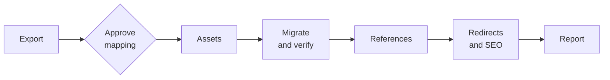

# Phases

Run order for a real migration:

All phases are implemented as scripts
and were exercised on a 10-entry pilot space; see `docs/bulk-plan.md` for the stage-by-stage status and
what has NOT been tested at scale.

## 1. Schema / mapping proposal: `scripts/propose_mapping.py`
Proposes `mapping/proposal.json` from exported Contentful content types and a snapshot of Builder's registered
components (`exports/builder_components.json`). It flags localized fields, references, rich text, asset links,
unique/validated fields and fields with no Builder equivalent, and marks close component matches as ambiguous.
It is a *proposal*: it never edits `mapping/field-mapping.json`. Only `scripts/mapping.py approve` (a human)
makes a mapping usable, and editing the mapping resets approval.

## 2. Asset migration (before content): `scripts/migrate_assets.py`
Uploads only the assets that entries actually reference to Builder's Upload API, dedupes by content hash, records
`exports/asset_map.json` (asset id → Builder URL) and logs each upload. Dry-run by default. Mapping a Builder
image input to the uploaded URL is a (human-approved) mapping change; mapping v3 still drops image fields.

## Core pipeline
Manifest → migrator → verifier → reporter (agents, see `CLAUDE.md`) or the deterministic equivalents
`scripts/run_migration.py` and `scripts/run_verification.py`.

## 3. Reference resolution (second pass): `scripts/reconcile.py`
Components referenced from a page are inlined as blocks, so most links never need resolving. `reconcile.py` checks
that every Entry link in the export is inlined, resolved through the id map, or deliberately dropped (anything else
is reported as UNCOVERED), syncs inlined components' manifest rows with their parent page (after a live re-check),
and writes `exports/id_map.json` / `exports/inline_map.json`. True Builder-to-Builder reference rewriting is not
needed by the current mapping and is not implemented.

## 4. Redirect / SEO check: `scripts/seo_redirect_check.py`
Compares each source URL with the URL its Builder draft actually has (same / rewritten / mismatch / not migrated /
target missing), flags collisions with existing Builder pages, writes a redirect-map CSV, and lists SEO-like source
fields and gaps versus the Builder page model.
